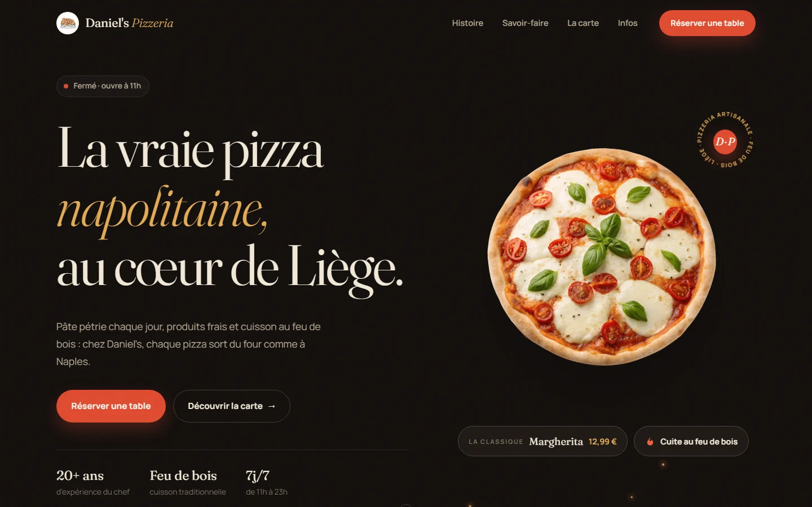

<div align="center">

# 🍕 Daniel's Pizzeria

**Site vitrine d'une pizzeria artisanale à Liège : pâte pétrie chaque jour, cuisson au feu de bois.**

Une seule page, 100 % statique, sans framework ni étape de build.


<a href="https://danidois2002.github.io/Pizzeria/"></a>

🔗 **[danidois2002.github.io/Pizzeria](https://danidois2002.github.io/Pizzeria/)**

<a href="https://danidois2002.github.io/Pizzeria/"></a>

</div>

---

## ✨ Fonctionnalités

| | |
|---|---|
| 🟢 **Statut en direct** | Badge « Ouvert maintenant » / « Fermé · ouvre à 11h » calculé à l'heure de Bruxelles, jour actuel mis en évidence dans les horaires |
| 🍕 **Carte interactive** | 4 catégories en onglets avec indicateur animé, prix au format belge (`12,99 €`), badges *Signature* et *Végétarien*, grand aperçu du plat au survol |
| 📅 **Réservation** | Choix du nombre de convives, date, créneaux midi / soir (les heures passées sont grisées), résumé en direct et messages d'erreur clairs |
| 🎬 **Vidéo de présentation** | Ouverte dans une fenêtre native `<dialog>`, chargée uniquement au clic |
| 🗺️ **Nous trouver** | Plan Google Maps en version sombre, bouton itinéraire, liens d'appel et d'e-mail directs |
| ✨ **Finitions** | Pizza qui tourne, sceau circulaire, braises animées, bandeau défilant, apparitions au scroll, compteurs animés |

## 🛠️ Technologies

- **HTML5** sémantique : `<dialog>`, `<fieldset>`, rôles ARIA pour les onglets
- **CSS3** : variables, Grid, Flexbox, animations sur `transform` / `opacity` uniquement
- **JavaScript** natif : `IntersectionObserver`, `Intl.DateTimeFormat`, `Intl.NumberFormat`
- **Polices** : [Fraunces](https://fonts.google.com/specimen/Fraunces) (titres) et [Manrope](https://fonts.google.com/specimen/Manrope) (texte)

## ⚡ Performance

- **Images en WebP** : les 20 photos du menu passent de 15 Mo à 0,9 Mo, en gardant leur transparence
- **Vidéo recompressée en 720p** : de 37 Mo à 1,3 Mo, et elle n'est téléchargée qu'à l'ouverture
- **Chargement différé** (`loading="lazy"`) pour toutes les images situées plus bas dans la page
- **Aucun écran de chargement**, aucune bibliothèque JavaScript : la page s'affiche immédiatement

## ♿ Accessibilité

- Navigation complète au clavier : lien d'évitement, focus visible, onglets pilotables avec les flèches
- Textes alternatifs sur les images, libellés ARIA sur les boutons icônes
- Respect du réglage système « réduire les animations » (`prefers-reduced-motion`)

## 🚀 Lancer le projet en local

Aucune installation n'est nécessaire.

```bash
git clone https://github.com/Danidois2002/Pizzeria.git
cd Pizzeria
```

Ouvrez ensuite `index.html` dans votre navigateur, ou servez le dossier avec n'importe quel serveur local (WAMP, `npx serve`, l'extension Live Server de VS Code…).

## 📁 Structure

```
Pizzeria/
├── index.html              # la page : hero, histoire, savoir-faire, carte, réservation, infos
├── styles.css              # la direction artistique (palette crème / tomate / or)
├── script.js               # la carte (données MENU), la réservation, le statut, la vidéo
├── docs/
│   └── preview.webp        # capture utilisée dans ce README
└── assets/img/
    ├── menu/               # les 20 photos détourées des plats (1.webp → 20.webp)
    ├── hero-pizza.webp     # la pizza du haut de page
    ├── craft-*.webp        # les 3 photos « savoir-faire »
    ├── flatlay.webp        # le fond de la section réservation
    ├── histoire-720p.mp4   # la vidéo de présentation
    ├── histoire-poster.webp
    ├── logo.png
    └── logo.ico
```

## 🍕 Modifier la carte

Toute la carte est décrite dans le tableau `MENU`, en haut de `script.js` :

```js
{ cat: 'pizza', name: 'Margherita', desc: 'Tomate, mozzarella, basilic', price: 12.99, img: 3, badge: 'veggie' },
```

| Champ | Rôle |
|---|---|
| `cat` | `pizza`, `salade`, `dessert` ou `boisson` |
| `name`, `desc` | nom et description du plat |
| `price` | prix en euros (le formatage `12,99 €` est automatique) |
| `img` | numéro de la photo dans `assets/img/menu/` |
| `badge` | *(facultatif)* `signature` ou `veggie` |

Pour ajouter une photo de plat (PNG détouré), convertissez-la en WebP, par exemple avec [ffmpeg](https://ffmpeg.org/) :

```bash
ffmpeg -i ma-pizza.png -vf "scale='min(560,iw)':-1" -c:v libwebp -quality 82 assets/img/menu/21.webp
```

> [!TIP]
> Après une modification de `styles.css` ou `script.js`, augmentez le numéro `?v=` à la fin des liens dans `index.html` : les visiteurs recevront la nouvelle version au lieu de celle en cache.

## 📝 À propos

Projet de démonstration : **Daniel's Pizzeria est une pizzeria fictive**. Le téléphone et l'adresse e-mail sont factices, et l'adresse postale sert uniquement d'exemple. Le formulaire de réservation ne passe par aucun serveur : il prépare un e-mail dans l'application de messagerie du visiteur (`mailto:`).

---

<div align="center">

Conçu et développé par **Danial Bitar**

[GitHub](https://github.com/Danidois2002) · [LinkedIn](https://www.linkedin.com/in/daniel-bitar-992ab3258)

</div>
